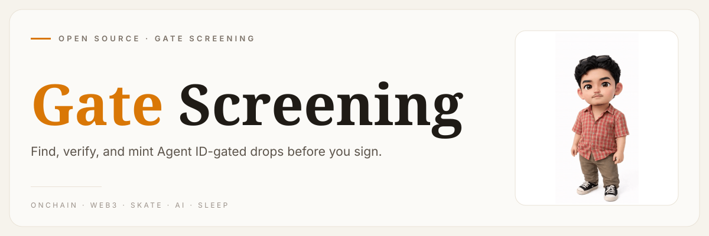
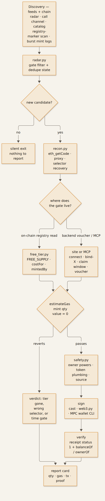

**[urelkdubdqwr](https://github.com/urelkdubdqwr)** · [website](https://studiopinggirkasur.xyz/)

<!-- agentid-gate-screening — how to screen Agent ID-gated NFT/token drops -->



**Screen a `.ai` Agent ID–gated drop before you sign: what it really costs, whether the free tier is still alive, and whether the contract deserves your wallet.**

## What it is

A standalone playbook plus six read-only screeners for the drops that gate on a Binance **Agent ID** (`.ai`) — NFT
collections, token launches, mint farms, whitelist rounds, MCP-driven claims, Merkle airdrops. It walks the whole path:
discovery feeds → bytecode truth → free-tier test → pre-mint risk check → transaction → on-chain verification.

The premise is that a landing page is not evidence. "Free mint" means `estimateGas(value = 0)` passes from your wallet
right now; "sold out" means `free_minted >= free_cap`; "gated" means the contract's own registry getter points at the
real Agent ID registry. Everything else is marketing with a countdown timer next to it.

Nothing here holds a key or signs anything. The scripts are read-only by design (`eth_call`, `eth_estimateGas`, public
HTTP APIs), so a cloned copy can never spend from your wallet — and there is no secret in it to leak. They also never
bypass a gate: a wallet without an Agent ID still cannot mint, which is the point.

## How it works



- **Discovery is polled, not awaited.** `scripts/radar.py` reads the public launch radar, the public call channel and
  the curated catalog, keeps only entries whose gate reference mentions the Agent ID registry, dedupes against a state
  file, and prints nothing when nothing is new — so it can run on a schedule without turning into noise. The chain-first
  half (new contracts carrying the registry marker, burst-mint logs) is in [`docs/11`](docs/11-chain-first-discovery.md).
- **Recon reads the dispatcher, not the tweet.** `scripts/recon.py` pulls runtime bytecode, detects EIP-1967 proxies,
  recovers every function selector and names them (4byte / openchain). That is how a contract exposing only
  `openFree()` `0x1644fa8e` and `agentRegistry()` `0x0d1cfcae` — names no template expects — still gets judged
  correctly instead of written off as a dead end.
- **"Free" is a simulation, not a claim.** `scripts/free_tier.py` reads `FREE_SUPPLY` / `MAX_SUPPLY` /
  `MAX_PER_WALLET` / `price` / `mintedBy(you)` / `costFor(qty)`, then simulates `mint(qty)` with `value = 0`. Pass =
  the mint is free for that quantity; revert = decode the selector, then check whether the value that *is* demanded
  comes back through a `claimFree()`/refund path — which makes it a deposit, not a price
  ([`docs/12`](docs/12-deposit-refund-farms.md)).
- **Safety is mechanical before it is judgement.** `scripts/safety.py` reports source verification, upgradeability,
  owner powers (`pause`, `withdraw`, `transferOwnership`), the payee, and whether the mint path carries approvals or
  `transferFrom` — the plumbing a drainer needs.
- **Verify with the contract's own view.** After signing (Foundry `cast`, a small `web3.py` script, or an MPC agent
  wallet CLI), success is `receipt.status == 1` **plus** a moved balance or an ownership mapping that names your
  wallet. `BROADCASTED` is not a result.

Verdict rules — full logic in [`docs/03-verify-onchain.md`](docs/03-verify-onchain.md):

| Evidence | Meaning |
| --- | --- |
| `estimateGas(mint, value = 0)` passes | the mint is free, or a fully refundable deposit — read the spec |
| `estimateGas` reverts | tier gone, wrong selector, or a time gate — decode before concluding |
| `free_minted >= free_cap` | free slot dead; paying does not "unlock" it |
| `agentIdRegistry()` / `agentRegistry()` = `0x60B9…022F` | the real Binance Agent ID registry is enforced |
| landing page says "free" | worthless on its own — never evidence |

## Quickstart

```bash
git clone https://github.com/urelkdubdqwr/agentid-gate-screening.git
cd agentid-gate-screening

./smoke.sh                       # read-only: runs every screener against a live gated contract
./smoke.sh 0xYourWallet          # optionally include the wallet-dependent checks

# the manual path, one command at a time
python3 scripts/gate_check.py --wallet 0xYourWallet          # do you even hold a .ai Agent ID?
python3 scripts/recon.py 0xContract                          # code size, proxy, selectors, gate getter
python3 scripts/free_tier.py --wallet 0xYourWallet --qty 1 0xContract
python3 scripts/safety.py 0xContract                         # owner powers, plumbing, source check
python3 scripts/radar.py --hours 24 --free-only              # what is live right now
python3 scripts/sweep.py --wallet 0xYourWallet --free-only   # batch: which live drops pass the gate, free
```

Needs Python 3.9+ and one public BNB Chain RPC (default `https://bsc-dataseed.binance.org`, override with `--rpc` or
`RPC_URL`). No `pip install`, no API key, no account. Ethereum-side rounds are screened with the same scripts by passing
an Ethereum RPC.

## The recipes

Read in order if you are new; jump by symptom if you are not.

| Recipe | Use it when |
| --- | --- |
| [`00` what is an Agent ID](docs/00-what-is-agent-id.md) | you need to know what the gate *is* (registry, handle, token id) |
| [`01` gate mechanics](docs/01-gate-mechanics.md) | deciding whether the gate is on-chain (registry read) or backend (voucher) |
| [`02` discovery](docs/02-discovery.md) | filling a watchlist of drops from public feeds |
| [`03` verify on-chain](docs/03-verify-onchain.md) | judging any contract: proxy, selectors, free tier, verdict |
| [`04` risk checklist](docs/04-risk-checklist.md) | before pressing sign: owner powers, drainer plumbing, approvals |
| [`05` execute & verify](docs/05-execute-and-verify.md) | building calldata, signing, proving the mint landed |
| [`06` automation](docs/06-automation.md) | turning the loop into a watcher that is quiet when nothing happens |
| [`07` case studies](docs/07-case-studies.md) | seeing the mechanics on real drops and real transactions |
| [`08` MCP drops](docs/08-mcp-drops.md) | the drop runs over an MCP server: sign-in → claim → window → ticket → mint |
| [`09` whitelist rounds](docs/09-whitelist-registration.md) | allocation comes from the site API (`connect`/`bind-x`/`task`/`voucher`), not the contract |
| [`10` bytecode ABI recovery](docs/10-bytecode-abi-recovery.md) | the contract is unverified and the usual selectors revert into the void |
| [`11` chain-first discovery](docs/11-chain-first-discovery.md) | you want drops before the announcement: registry fingerprint + burst mints |
| [`12` deposit-refund farms](docs/12-deposit-refund-farms.md) | `value > 0` but there is a `claimFree`/refund exit — solvency and emission math |
| [`13` FCFS races](docs/13-fcfs-races.md) | the sale opens at a block time and slots die in seconds |
| [`14` smart-wallet follow](docs/14-smart-wallet-follow.md) | building a watchlist of wallets that keep winning, with entry/exit rules |
| [`15` Merkle claims](docs/15-merkle-claims.md) | the payout is an airdrop claim, not a mint |

## What's inside

| Path | What it is |
| --- | --- |
| [`scripts/gate_check.py`](scripts/gate_check.py) | does this wallet hold a `.ai` Agent ID? |
| [`scripts/recon.py`](scripts/recon.py) | bytecode, proxy detection, selector recovery + naming |
| [`scripts/free_tier.py`](scripts/free_tier.py) | free-tier state reads + `value = 0` simulation |
| [`scripts/safety.py`](scripts/safety.py) | owner powers, token plumbing, source verification |
| [`scripts/radar.py`](scripts/radar.py) | live discovery of new Agent ID–gated launches |
| [`scripts/sweep.py`](scripts/sweep.py) | batch screen every gated launch at once: `estimateGas(value 0)` per contract |
| [`scripts/lib.py`](scripts/lib.py) | JSON-RPC + ABI-shim helpers shared by the above |
| [`smoke.sh`](smoke.sh) | read-only proof the repo works from a fresh clone |
| [`data/known-drops.csv`](data/known-drops.csv) | verified Agent ID–gated drops and their free rule |
| [`data/field-notes.md`](data/field-notes.md) | traps, false verdicts, timings |
| `assets/diagram.mmd` + `assets/ecosystem.png` | pipeline diagram, source + render |

## License

MIT — see [LICENSE](LICENSE).

*Worked from the edge of the bed. → [studiopinggirkasur.xyz](https://studiopinggirkasur.xyz/)*
